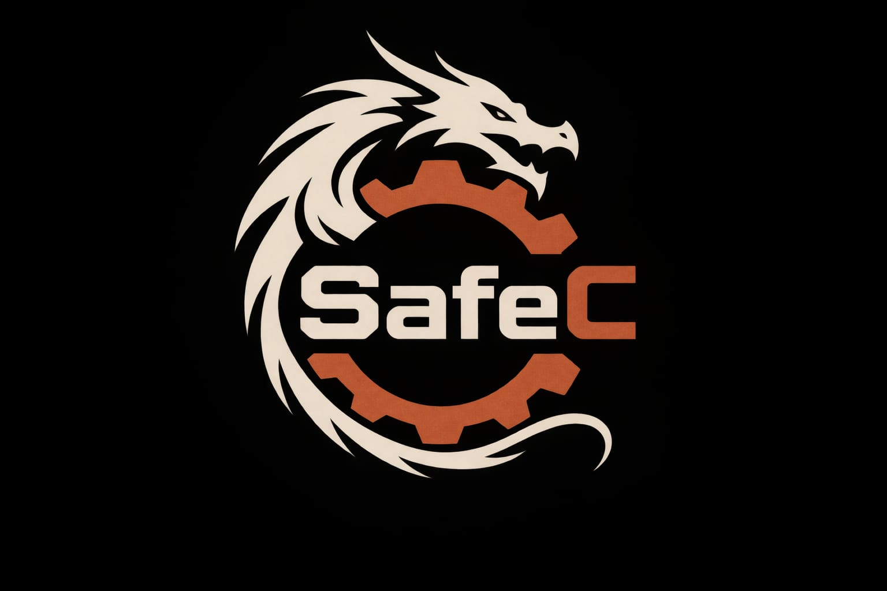

<p align="center">
  
</p>

<p align="center">
  <b>A memory-safe C-family language on LLVM.</b><br>
  C syntax and C's memory model, with compile-time ownership, borrowing and null safety.
</p>

---

SafeC keeps the look and low-level style of C and adds an ownership-based type
system that the compiler checks before it generates any code. Use-after-free,
double free, null dereferences, reads of uninitialized variables and leaks of
owned memory are rejected at compile time. Out-of-bounds array indexing and
integer overflow stop the program at run time instead of corrupting memory.

There is no garbage collector and no runtime library: `new` and `free` use the
C library's allocator, every SafeC pointer is a plain machine pointer, and
SafeC follows the C calling convention of x86-64 Linux, so SafeC and C object
files link into one program.

The full language specification is in the [whitepaper](docs/WHITEPAPER.pdf).

## Features

- **Non-null by default.** `T*` can never be `null`. Nullable pointers are
  written `T*?` and must be checked against `null` before use; the check
  narrows the type inside `if`, `while`, early returns, and `&&` / `||` / `!`
  conditions.
- **Single ownership.** `own T*` is the sole owner of a heap allocation.
  Assigning it, storing it or passing it moves ownership and invalidates the
  source. `free` consumes an owner.
- **Leak detection.** An owner that goes out of scope, is overwritten, or is
  dropped on an early `return`, `break` or one branch of an `if` while still
  holding memory is a compile-time error.
- **Second-class borrows.** `T*` (read) and `mut T*` (write) borrows follow
  shared-xor-mutable rules and live only in local variables and parameters.
  They can't be stored or returned, so borrow checking is done one function at
  a time, with no lifetime annotations.
- **`defer`.** Schedules a statement (usually `free`) to run at every exit of
  the enclosing block.
- **`trusted` and `raw`.** Unchecked `raw T*` pointers can be dereferenced,
  indexed and offset only inside explicit `trusted { ... }` blocks: the only
  places a reviewer needs to audit.
- **Defined behaviour.** Bounds-checked arrays, trapping signed overflow,
  division by zero and bad shifts, and left-to-right evaluation order.
- **C interoperability.** Declare C functions and globals the way C does;
  structs pass by value in both directions. SafeC objects built with `-c` are
  callable from C.
- **Debuggable.** `-g` emits DWARF debug info for `gdb` and `lldb`.

## A quick look

```c
struct Point {
    int x;
    int y;
};

void shift(mut struct Point* p, int dx) {     // write borrow: caller keeps ownership
    p->x += dx;
}

int main() {
    own struct Point* p = new struct Point;   // zero-initialized, never null
    defer free(p);                            // released when main returns

    shift(p, 5);
    printf("(%d, %d)\n", p->x, p->y);         // (5, 0)
    return 0;
}
```

The compiler rejects the usual C mistakes:

```c
struct Node { int value; };

int main() {
    own struct Node* a = new struct Node;
    own struct Node* b = a;      // ownership moves to b
    a->value = 1;                // use after move
    return 0;                    // b is never freed
}
```

```
bugs.safec:6: error: use of moved pointer 'a'
bugs.safec:5: note: 'a' moved here
bugs.safec:7: error: 'b' is leaked when returning
bugs.safec:4: note: allocated here
```

### Pointer kinds

| Type      | Meaning           | Read | Write | Frees memory |
| --------- | ----------------- | ---- | ----- | ------------ |
| `own T*`  | Owning pointer    | yes  | yes   | yes (sole owner) |
| `T*`      | Read borrow       | yes  | no    | no |
| `mut T*`  | Write borrow      | yes  | yes   | no |
| `raw T*`  | Unchecked pointer | in `trusted` only | in `trusted` only | no |

Add `?` to any of them (`own T*?`, `T*?`, ...) to allow `null`.

## Building

**Requirements**

- `flex` and `bison` 3.0 or newer
- A C11 compiler and a C++17 compiler (`cc`, `c++`)
- `clang` (LLVM): compiles and links the IR that `safec` generates
- For the test suite: LLVM's `opt` and `llvm-dwarfdump`; `gdb` is optional

SafeC is developed and tested with LLVM 18 on x86-64 Linux.

```bash
git clone https://github.com/Adam-Warlock09/Safe-C.git
cd Safe-C
make            # builds ./safec
make test       # runs the test suite
```

`make clean` removes build artifacts.

## Usage

```bash
./safec prog.safec -o prog
./prog
```

`safec` runs lexing, parsing, semantic analysis and the borrow checker,
generates LLVM IR, and hands it to `clang`, which optimizes it, compiles it and
links it with the C library.

### Command-line options

| Option | Effect |
| --- | --- |
| `-o <file>` | Output file (default `a.out`) |
| `-c` | Compile to an object file; no `main` is required, so C programs can link it |
| `-S`, `--emit-llvm` | Write the LLVM IR and stop (optimized IR with `-O1`..`-O3`) |
| `-O0` .. `-O3` | Optimization level |
| `-g` | Emit DWARF debug info |
| `-l <lib>`, `-L <dir>` | Libraries to link and where to find them (e.g. `-lm`) |
| `--till-lexer` | Print the token stream and stop |
| `--till-parser` | Print the AST and stop |
| `--till-sema` | Run all compile-time checks and stop |
| `*.c`, `*.o`, `*.a`, `*.so` | C sources, objects and libraries compiled and linked with the program |

Examples:

```bash
./safec --till-sema prog.safec           # only check the program
./safec -O2 prog.safec -o prog           # optimized executable
./safec -S -O2 prog.safec -o prog.ll     # inspect the optimized IR
./safec -g prog.safec -o prog && gdb ./prog
```

### Runtime checks

Outside `trusted` blocks the compiler inserts checks that stop the program
(`llvm.trap`, an illegal-instruction signal on x86-64) on:

- an index out of bounds of a sized array;
- signed overflow of `+`, `-`, `*`, unary `-`, `++`, `--` and compound
  assignment;
- division or remainder by zero, and `INT_MIN / -1`;
- shifts by a negative amount or by 32 or more.

LLVM removes checks it can prove never fail. Inside `trusted`, no checks are
emitted and integer arithmetic wraps as in C, which is how a hot loop opts out
of the checks.

## Working with C

### Calling C from SafeC

Declare C functions and globals as you would in C. `printf` is built in;
anything else needs a declaration, since SafeC has no preprocessor.

```c
// SafeC: main.safec
struct Point { int x; int y; };

struct Point midpoint(struct Point a, struct Point b);   // defined in C
extern int requests_served;                              // a C global
int abs(int x);                                          // from libc
float sqrtf(float x);                                    // from libm

int main() {
    struct Point m = midpoint((struct Point){ 0, 0 }, (struct Point){ 10, 20 });
    printf("(%d, %d) %d %.3f\n", m.x, m.y, abs(-7), sqrtf(2.0));
    requests_served += 1;
    return 0;
}
```

Pass the C files and libraries on the same command line:

```bash
./safec main.safec helpers.c -lm -o app
```

### Calling SafeC from C

Compile the SafeC module to an object file with `-c` and link it like any C
object:

```bash
./safec -c stats.safec -o stats.o
clang main.c stats.o -o app
```

The C side declares the SafeC functions with ordinary C prototypes.

### Rules at the boundary

- A function without a body is a declaration of an external function;
  `extern` is optional on functions. `extern` globals can't have an
  initializer.
- `...` is allowed only in declarations of C functions. A SafeC function
  can't be variadic.
- Ownership annotations in a C declaration are trusted: `own T*` hands
  ownership across the call, `T*` and `mut T*` are borrows for its duration.
  Memory that C returns as `own` must come from `malloc` or `calloc`. Memory
  that C keeps is handled through `raw` pointers inside `trusted`.
- `malloc`, `calloc`, `realloc` and `free` are reserved and can't name SafeC
  functions or globals.
- Only C functions whose types SafeC can write can be declared: `int`, `char`,
  `bool`, `float`, pointers, and structs of these.

## Demos

`tests/demo/` holds twelve short programs covering use-after-free, null safety,
leaks, `defer`, borrow rules, runtime checks, the linked-list case study, and
linking with C in both directions:

```bash
bash tests/demo/run_demo.sh          # all demos
bash tests/demo/run_demo.sh 06 09    # selected demos
```

## Testing

```bash
make test                                # the full suite
bash tests/run_tests.sh --sema           # every stage up to sema
bash tests/run_tests.sh --safec --only   # only build and run the programs
bash tests/run_tests.sh -v               # list every test
```

Stage flags: `--lexer`, `--parser`, `--sema` (includes the borrow checker),
`--codegen`, `--safec`, `--interop`, `--driver`. Each runs every stage up to
it, or only that stage with `--only`.

The suite has 322 tests across eight stages: lexer, parser, sema, borrow
checker, LLVM IR, compiled-program execution (exit codes, traps and exact
output), C interop, and the command line. Programs in `pass/` directories must
compile and run correctly; programs in `fail/` directories must be rejected
with the errors marked on the expected lines.

### Performance

`tests/bench/` compares five programs written in SafeC and in plain C, both
built with `-O2`:

```bash
bash tests/bench/run_bench.sh
```

On an x86-64 Linux machine, four benchmarks run at 94–112% of C's time. The
integer-heavy `collatz` runs at about 160–180%, because of overflow checks;
moving its inner loop into a `trusted` block brings it to C's speed. Timings
vary between machines.

## Repository layout

```
src/
  lexer.l, tokens.h         flex lexer and token codes
  parser.y, new_ast.h       bison LALR(1) grammar and the AST
  sema.cpp                  types, null narrowing, definite assignment
  borrowck.cpp              ownership and borrow checker
  codegen_*.cpp             LLVM IR generation, C ABI, debug info
  driver.cpp                the safec command line
tests/
  cases/<stage>/{pass,fail} the test suite
  demo/                     demo programs
  bench/                    benchmarks against C
docs/
  WHITEPAPER.pdf            language specification
  GRAMMAR.md                lexical and syntactic grammar
```

## Limitations

- Borrow checking is intraprocedural: a caller can't rely on what a callee did
  through a write borrow, so ownership transfers must be visible in the caller.
- Borrows held in local variables last until the end of their block, not their
  last use.
- Unsized array parameters (`int xs[]`) are not bounds-checked.
- The C calling convention is implemented for x86-64 Linux only.
- Diagnostics report lines but not columns, and parsing stops at the first
  syntax error.
- Not supported: `union`, `enum`, `typedef`, `goto`, `do`/`while`, `?:`,
  casts, `sizeof`, the preprocessor, `double`, `long`, `short`, `unsigned`,
  `void*`. Struct types are always written with `struct`.
- No threads and no data-race guarantees.

## Documentation

The [whitepaper](docs/WHITEPAPER.pdf) is the full language specification: design
rationale, comparison with C, Rust, Checked C and Hylo, and implementation
details. The lexical and syntactic grammar is in [docs/GRAMMAR.md](docs/GRAMMAR.md).

## Team

SafeC was built as a compilers course project by Atul Boyal, Akshat Banzal,
Aric Maji, Rishika Shreya Fadi, Harikrishna S, Chakram Siri and Aare Renu Shri.
